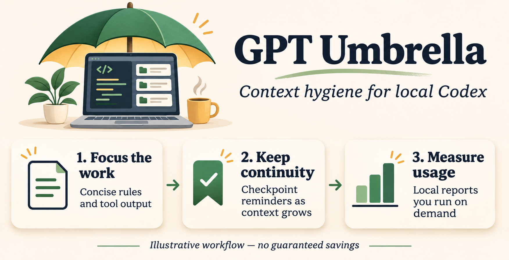

# GPT Umbrella — for OpenAI Codex

**Help Codex keep its working context focused, remember progress, and measure token usage.**

GPT Umbrella is the OpenAI Codex edition of [Ideal-Umbrella](../README.md). It installs
working rules and a local checkpoint reminder. You can also run reports to see where
context and tokens go. It does not guarantee lower costs.



*Illustrative workflow, not an app screenshot or measured savings result.*

[Install](#install-step-by-step) · [Make Codex use it](#how-do-i-make-codex-use-it) ·
[Check usage](#run-your-first-usage-report) · [Troubleshooting](#troubleshooting) ·
[Technical reference](docs/reference.md)

## Is this for me?

Use this edition with the **local Codex desktop app or Codex CLI**. You need
**Python 3.11 or newer** and Git. GPT Umbrella itself needs no API key, paid API call,
or extra Python package. Your normal Codex access is separate.

This does not install into ordinary ChatGPT web chats. Claude Code users should follow
the [Claude guide](../README.md). Keep the installers separate: `gpt/umbrella.py` is
for Codex; the root `config/install.py` is for Claude Code.

## What actually happens?

| Part | What it does | When it runs |
| --- | --- | --- |
| Working rules | Ask Codex to focus searches, bound tool output, and maintain a concise checkpoint. | Loaded as instructions when Codex starts a session. |
| Optional budgets | Add starting limits for tool output and skill context when those settings are not already owned. | Applied through local Codex configuration. |
| Checkpoint reminder | Checks recent reported context use and can remind Codex to save progress. | At prompt time, after hook review/trust, when a usable estimate crosses a reminder band. |
| Usage reports | Report input, cached input, output, and tool-output sizes from available local logs. | Only when you or your agent run an analysis command. |

A **checkpoint** is a short note with the objective, decisions, changed files, checks,
open issues, and next action. The reminder asks the agent to write it; it does not write
the note itself. Rules are guidance, not a guarantee of agent behavior.

## Install step by step

Open PowerShell on Windows, or a terminal on macOS/Linux. Check your tools:

```powershell
python --version
git --version
```

If your system uses `python3`, substitute it for `python` in every command below.
If needed, install [Python](https://www.python.org/downloads/) and
[Git](https://git-scm.com/downloads) first.

### 1. Download this edition

The GPT edition is included in the main Ideal-Umbrella repository:

```powershell
git clone https://github.com/StepenkoAnatoli/Ideal-Umbrella.git
cd Ideal-Umbrella/gpt
```

Run the remaining commands from this `gpt` directory. If you already cloned the repository,
update your checkout and enter `gpt` instead of cloning another copy.

### 2. Preview the changes

```powershell
python -I umbrella.py install --dry-run
```

This lists what would change without installing anything. `-I` isolates Python from
Python environment variables and user site packages.

### 3. Install and check the files

```powershell
python -I umbrella.py install
python -I umbrella.py verify
```

Look for `"files_match_install": true`. The installer backs up files before changing them.
It preserves your existing model, reasoning effort, permissions, and tool access.
See [what it installs](#what-files-does-it-change).

### 4. Load the setup in Codex

Start a **new local Codex chat**, or relaunch the CLI, to load configuration and instructions.
Keep your existing chats; you do not need to delete your history.

In the desktop app, open **Settings > Hooks** (or **Review hooks** if shown). In the CLI,
open **`/hooks`**. Review and trust the **GPT Umbrella context monitor** if Codex requests it.
New or changed hook definitions need review before execution.
[Official hook instructions](https://learn.chatgpt.com/docs/hooks).

### 5. Confirm the instructions are loaded

Paste this into that new Codex chat:

> Check whether the GPT Umbrella rules are loaded from my global AGENTS.md. Summarize the active rules and keep a concise checkpoint for this task.

`verify` checks files; this prompt checks what instructions the agent can see. Neither
alone proves the hook executed. The hook normally stays quiet below its reminder threshold.

## How do I make Codex use it?

**Install once for your local Codex profile. You do not need to paste this README into every chat.**

The working rules go in your global `AGENTS.md`, which Codex reads when it builds a
session's instructions. A global `AGENTS.override.md` can replace that file, and project
instructions can add more specific guidance.
[How Codex loads instructions](https://learn.chatgpt.com/docs/agent-configuration/agents-md).

You can also ask directly:

> Use GPT Umbrella's workflow for this task. Keep searches focused, save long logs to files, and update the checkpoint after meaningful progress.

The automatic reminder needs a trusted hook. Reports are separate commands you can run
yourself or ask the agent to run. GPT Umbrella does not switch models, lower reasoning
effort, disable tools, restart chats, or compact history.

## What files does it change?

Codex home defaults to `%USERPROFILE%\.codex` on Windows or `~/.codex` on macOS/Linux.
If you set `CODEX_HOME`, that directory is used instead.

| Inside Codex home | Purpose |
| --- | --- |
| `AGENTS.md` | Adds a clearly marked GPT Umbrella rules section. |
| `config.toml` | Adds missing budgets with the balanced preset; preserves existing settings. |
| `hooks.json` | Registers the prompt-time monitor alongside existing hooks. |
| `gpt-umbrella/runtime/` | Stores the Python code used by the hook. |
| `gpt-umbrella/backups/` and `gpt-umbrella/install-record.json` | Store backups and track installer ownership. |
| `gpt-umbrella/state/` | Stores reminder bands and compaction fingerprints, not chat text. |

The default **balanced** preset adds these values only when the setting/table is absent:

```toml
tool_output_token_limit = 6000

[skills]
max_context_tokens = 5000
```

These are experimental starting budgets, not measured optimal settings. An existing
`skills` table is preserved in full. On an uninstalled profile, use
`python -I umbrella.py install --preset observe` to add rules and the monitor without
these budgets. Observe still adds instructions; it is not a passive baseline.

## Run your first usage report

After using a local Codex chat, return to `gpt` and run:

```powershell
python -I umbrella.py analyze --latest 3 --output output/usage.json
```

Open `output/usage.json` in a text editor, or ask Codex to explain it. It reports:

- Input and output tokens, with cache and reasoning subsets kept separate.
- Tool output ranked by **characters**, which are not token counts.
- Warnings about malformed records, incomplete history, or accounting differences.

This reads recent available JSONL files under Codex home. It is not an account bill or
a complete history: remote, archived, and child-agent files may need explicit paths.
Reports omit raw prompts, commands, and tool results, but contain metadata and deterministic
fingerprints. Check their contents before sharing them.

[More commands: comparisons, skill audits, API request audits, and rates](docs/reference.md).

## Troubleshooting

| What you see | What to do |
| --- | --- |
| `python` is missing, or `tomllib` is not found | Install Python 3.11+, or use `python3` if that is your installation. |
| `umbrella.py` cannot be found | Enter the repository's `gpt` directory. |
| No reminder appears | Check hook review/trust. Silence is normal below the threshold or without a reported context window. |
| Rules are missing in a new chat | Check Codex home and whether `AGENTS.override.md` replaces the global rules. |
| `verify` reports a changed file | Inspect that file. Codex or later user edits can change config; this is not automatically a broken hook. |
| No transcripts are found | Complete a local Codex task, or pass an explicit JSONL path. Remote history is not downloaded. |
| Uninstall preserves an edited block | Inspect it before reinstalling. It may contain settings added by Codex, including hook trust; do not blindly delete the block. |
| An install was interrupted or a lock remains | Follow the [recovery notes](docs/reference.md#undo-and-recovery). |

## Update or remove it

Updates use uninstall then reinstall; there is no in-place upgrade command. Review any
preservation notices before reinstalling:

```powershell
python -I umbrella.py uninstall --dry-run
python -I umbrella.py uninstall
```

To update, pull the latest source for your branch, then run `install` and `verify` again.
To remove it, stop after uninstall. Backups and reminder state are retained for inspection.
Later user edits are preserved where the installer cannot safely restore a file.

## Development and evidence

Version **0.1.2**. Standard-library runtime; no telemetry or network calls from the tool.
Run `python -m unittest discover -s tests -v` from `gpt/` for its tests. The existing
[repository CI](../.github/workflows/ci.yml) also runs the suite on its Python 3.12+ jobs
on Windows and Ubuntu. Python 3.11 is the code's minimum but is not in that matrix.

See [validation and limits](docs/validation.md), [GPT research](docs/gpt-research.md),
[review and fixes](docs/review-2026-11-17.md), [technical reference](docs/reference.md),
and [attribution](NOTICE.md). No matched task benchmark currently proves savings or better quality.
